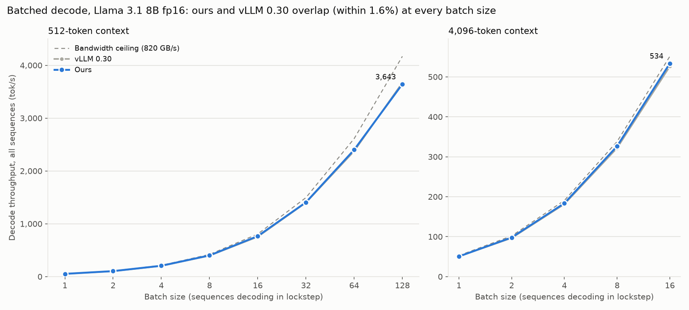
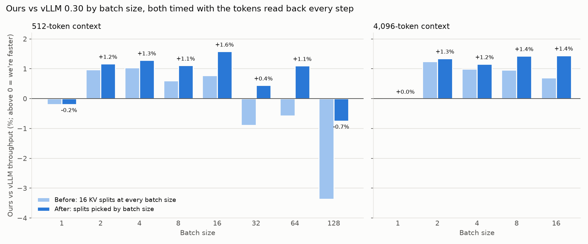
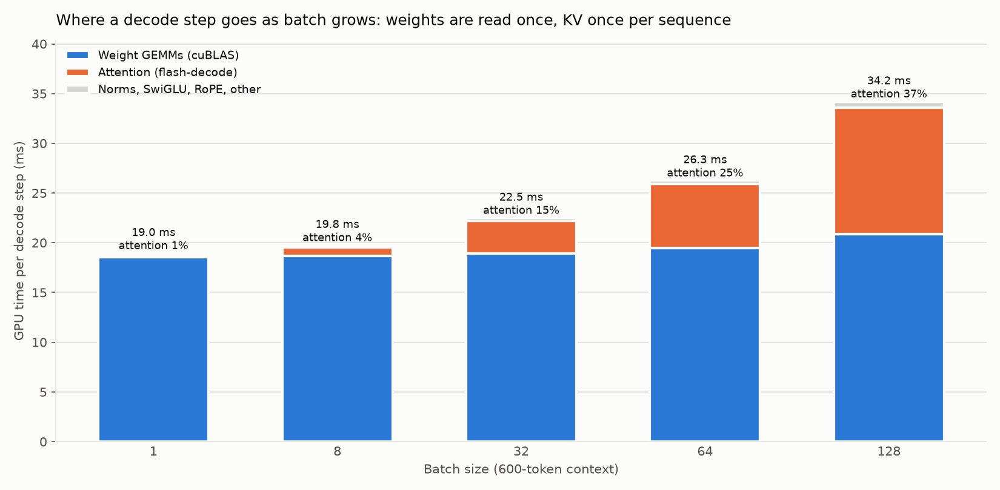
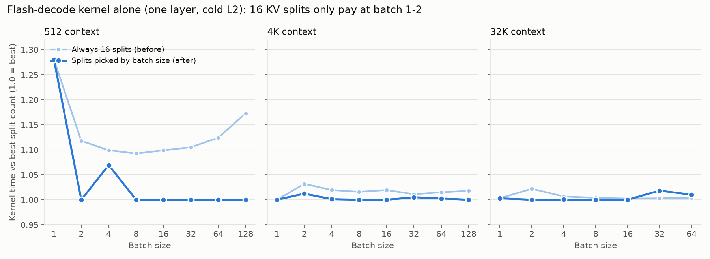

# Batched decode vs vLLM (2026-10-12)

*Llama 3.1 8B config, random fp16 weights, RTX PRO 4500 Blackwell (32 GB, 896 GB/s spec). Our engine
with CUDA graphs vs vLLM 0.30.0, batch 1 to 128, at 512 and 4K context.*



- **Batching worked out of the box.** Every kernel already had a batch axis in its grid and took
  batch strides (SwiGLU's strided-row fix landed in `b0b0935`), and `test_cuda_graphs` already
  covered batch 3. No correctness changes were needed.
- **Out of the box we were level with vLLM up to batch 16 and up to 3.4% behind from batch 32 on**
  (512 context). The cause was flash-decode's fixed 16 KV splits, a batch-1 design (see below).
- **After picking the split count from the batch size, we're within −0.7% to +1.6% of vLLM in
  every cell**: ahead in 10 of 13, level at batch 1, and 0.7% behind at 512 × 128. At 512 context,
  batch 128 runs 3,643 tok/s, 70× batch 1 on the same 15 GB of weights.
- **Batch 1 → 128 costs 1.8× the step time** (19.2 → 35.1 ms). Weights are read once per step
  whatever the batch; each sequence adds only its own KV reads, about 79 MB at 600 tokens.

## How it's measured

`benchmarks/sweep_batch.py` runs one process per cell. Each of the `batch` sequences holds a
`seq_len`-token context and decodes in lockstep: same length, no request arrivals. That's a
static batch, not continuous batching.

- **Ours:** `bench_throughput.py --cuda-graphs --generation-loop --batch-size N`. That's a real
  generation loop: forward, greedy argmax, all N tokens copied to the host, argmax fed back.
  It's timed per step on the host clock, the same accounting as the batch-1 vLLM comparison
  (`LONG_CONTEXT.md`). The loop costs 0.1–0.2 ms per step over CUDA-event timing, at every batch size.
- **vLLM:** `bench_throughput_vllm.py --batch-size N` sends N random prompts at once
  (`max_num_seqs=N`, prefix caching off) and times `engine.step()` on the host clock. A step
  counts only if every request already had a token and got exactly one more, so prefill and
  mixed prefill/decode steps are excluded. Each run times about 122 of 128 decode steps. It
  reports the median of 3 runs after a discarded warmup run; runs agreed within 0.02 ms.
- **Bandwidth floor:** 15.01 GB of weights plus 128 KiB of KV per cached token per sequence,
  at the ~820 GB/s the best isolated GEMVs reach here (`REPORT.md`). Context is averaged over
  the timed steps (seq_len + 94).

## Results

512-token context (tok/s, all sequences together):

| batch | ours, before | ours, after | vLLM 0.30 | after vs vLLM | after, ms/step | floor, ms | % of floor¹ |
|---:|---:|---:|---:|---:|---:|---:|---:|
| 1 | 52.0 | 52.0 | 52.1 | −0.2% | 19.22 | 18.40 | 97% |
| 2 | 103.6 | 103.8 | 102.6 | +1.2% | 19.27 | 18.50 | 97% |
| 4 | 204.6 | 205.1 | 202.5 | +1.3% | 19.50 | 18.69 | 97% |
| 8 | 399.0 | 401.0 | 396.6 | +1.1% | 19.95 | 19.08 | 96% |
| 16 | 759.7 | 765.8 | 753.9 | +1.6% | 20.89 | 19.85 | 95% |
| 32 | 1,387.2 | 1,405.9 | 1,399.7 | +0.4% | 22.76 | 21.40 | 94% |
| 64 | 2,361.0 | 2,400.9 | 2,374.8 | +1.1% | 26.66 | 24.50 | 92% |
| 128 | 3,547.3 | 3,643.4 | 3,670.8 | −0.7% | 35.13 | 30.70 | 88% |

4K-token context (batch 16 is the largest power of two that fits: ~9 GB of KV next to the weights):

| batch | ours, before | ours, after | vLLM 0.30 | after vs vLLM | after, ms/step | floor, ms | % of floor¹ |
|---:|---:|---:|---:|---:|---:|---:|---:|
| 1 | 50.5 | 50.5 | 50.5 | +0.0% | 19.79 | 18.97 | 96% |
| 2 | 97.8 | 97.9 | 96.6 | +1.3% | 20.44 | 19.64 | 97% |
| 4 | 183.2 | 183.5 | 181.4 | +1.2% | 21.80 | 20.98 | 97% |
| 8 | 325.0 | 326.5 | 321.9 | +1.4% | 24.50 | 23.66 | 97% |
| 16 | 529.9 | 533.8 | 526.2 | +1.4% | 29.98 | 29.02 | 97% |

¹ floor ÷ CUDA-event step time (no token readback).



## The fix: KV splits by batch size



The profile (`batch_breakdown.csv`, one eager step at 600 context, the same kernels the graph
replays) shows attention growing from 1% of the step at batch 1 to 37% at batch 128. GEMMs stay
nearly flat, which is the point of batching. Out of the box at batch 128, flash-decode was
12.84 ms generation + 0.53 ms reduce.

Flash-decode splits each (sequence, KV head) into `NUM_SPLITS` chunks. Each chunk writes a
partial result, and a second kernel merges them. The 16 fixed splits come from the batch-1 work
(`9bd7daf`), where 8 KV heads × 1 sequence would otherwise leave most of the 82 SMs idle. At
batch 128 the grid is already 1,024 programs without splitting. The 16 splits then just write
and re-read partial results, about 1 GB per step, and launch the reduce kernel 32 times.



The kernel alone (`batch_splits_kernel.csv`: one layer, CUDA-graphed, L2 flushed before each
call) for 1–16 splits at 512, 4K and 32K context:

- **Extra splits only cost at short context**, where the partial results are a sizable fraction
  of the KV read. At 512 context, 16 splits are 9–17% slower than 1 from batch 4 up. At 4K and
  32K they're within 3% at every batch.
- **Splitting only helps at batch 1–2.** At batch 1 and 32K, 1 split is 1.9× slower than 4–16;
  at batch 2 it's 1.1×. By batch 8, one split is best or within 2% everywhere.

`default_num_splits` in `kernels/flash_decode.py` now picks 16 splits at batch 1, 4 at batch 2,
2 at batch 3–7 and 1 from batch 8. With one split, the generation kernel writes the normalized
output directly into `out` (passed in as a `mid_o` view with the same tile layout), and there's
no reduce launch. `flash_decode(..., num_splits=N)` still overrides the default.

- **Batch 1 keeps 16 splits.** At 512 context 4 splits would save 0.7 µs per layer (~0.1% of a
  step), and 16 is what the long-context results up to 112K were tuned with.
- At batch 128 attention now reads its 10.1 GB of KV at ~795 GB/s. End to end, the change is
  +2.7% at batch 128, +1.7% at 64, +1.3% at 32, +0.1–0.8% at 2–16 and nothing at batch 1.
- `tests/test_flash_decode_gpu.py` now covers 1 and 2 splits and a 1,000-token context (not a
  multiple of any block size).

## What's left at large batch

At 512 × 128 we're at 88% of the bandwidth floor, against 96–97% at small batch. The rest is
outside our kernels:

- **cuBLAS GEMMs at M = 128** take 20.8 ms against 18.6 ms at M = 1. cuBLAS switches from
  GEMV to `cutlass_80` tensor-op tiles, which stream the weights at ~720 GB/s instead of ~800.
  Timed outside the model with L2 flushed, the five GEMM shapes take the same time under our
  torch 2.8 / CUDA 12.8 and vLLM's torch 2.13 / CUDA 13 (24.5 vs 24.4 ms at M = 128), so both
  engines pay this.
- **~0.9 ms of gaps between kernels.** The sum of kernel times is 34.2 ms, while the graph
  replays in 35.1 ms. At batch 1 the gap is under 0.1 ms. These are probably tail effects as
  each large GEMM drains. vLLM has `torch.compile` fusions and is 0.7% ahead at this one size.

## Caveats

- One run per cell for our engine (the generation loop averages 128 steps). Batch 1 matches the
  earlier `vllm_comparison.csv` (19.22 vs 19.24 ms ours, 19.18 vs 19.19 ms vLLM), and repeated
  batch-1 runs here were within 0.2%.
- Static batches only: equal context lengths, all sequences at the same position. The engine
  keeps one `decode_pos` for the whole batch, so ragged batches and continuous batching would
  need per-sequence positions (and, for vLLM-style serving, a paged KV cache). vLLM was run the
  same way, so the comparison is like for like, but it doesn't measure what vLLM's scheduler
  adds under real traffic.
- 512 × 256 doesn't fit next to the weights in either engine (~23 GB of KV).
- Random weights, random K/V for the prior context; throughput doesn't depend on the values.

## Reproduce

```bash
# vLLM in its own venv (see LONG_CONTEXT.md); ~30 min for both contexts
python benchmarks/sweep_batch.py --seq-lens 512 --csv batch_512.csv
python benchmarks/sweep_batch.py --seq-lens 4096 --batch-sizes 1 2 4 8 16 --csv batch_4k.csv
python docs/perf_history/batch_charts.py    # redraws the four batch_*.png from the CSVs here
```

Data: `batch_sweep.csv` (`engine_version` baseline = 16 fixed splits, adaptive-splits = after
the fix), `batch_breakdown.csv` and `batch_splits_kernel.csv`. Every run is also in
`benchmarks/results/throughput_runs.csv` (note `batch-sweep baseline` / `batch-sweep adaptive-splits`).
