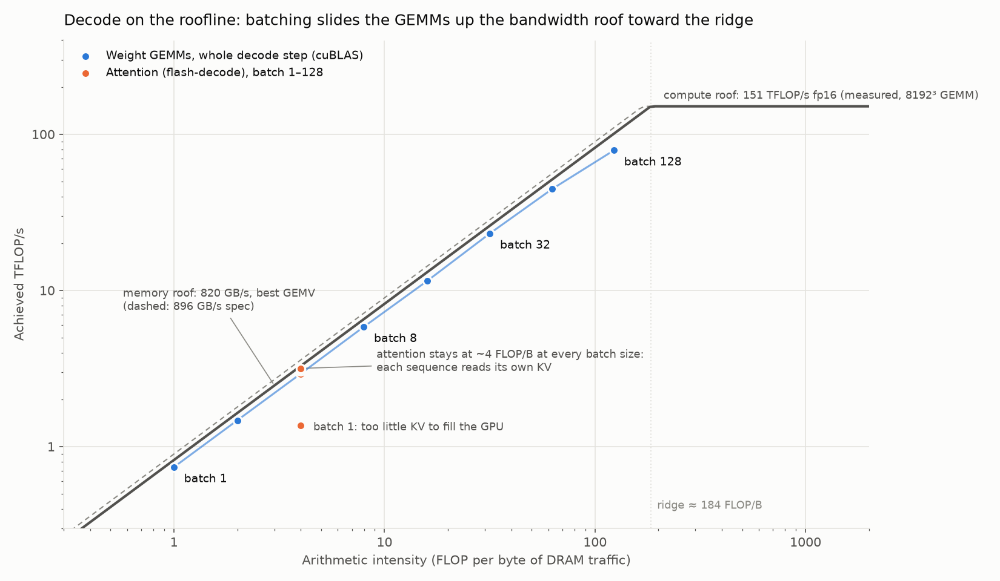
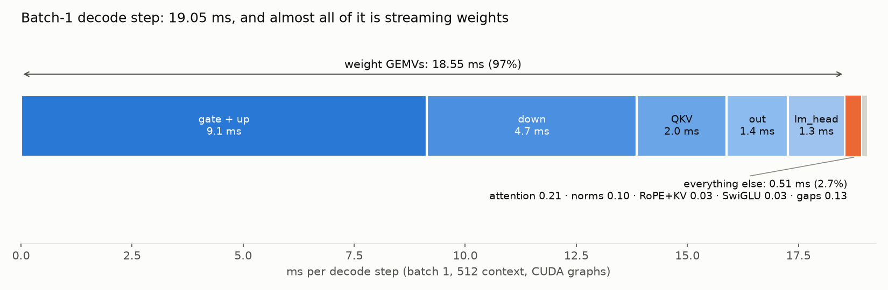
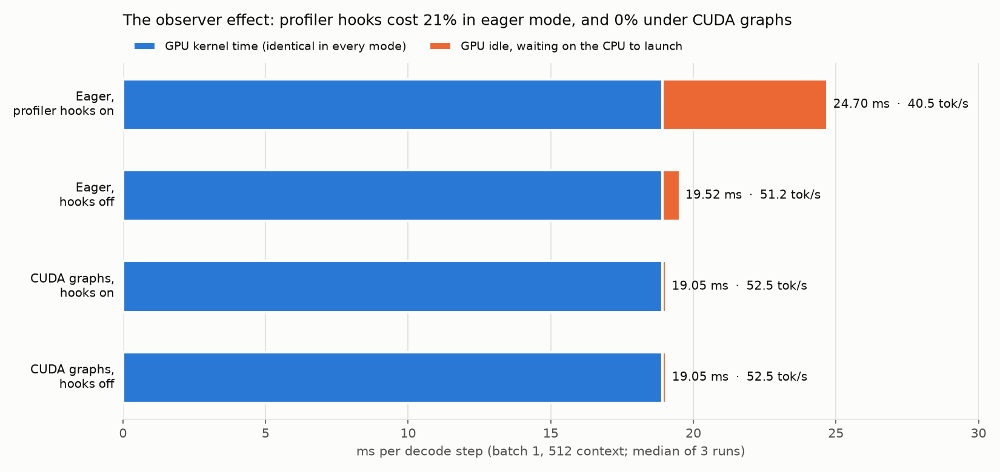
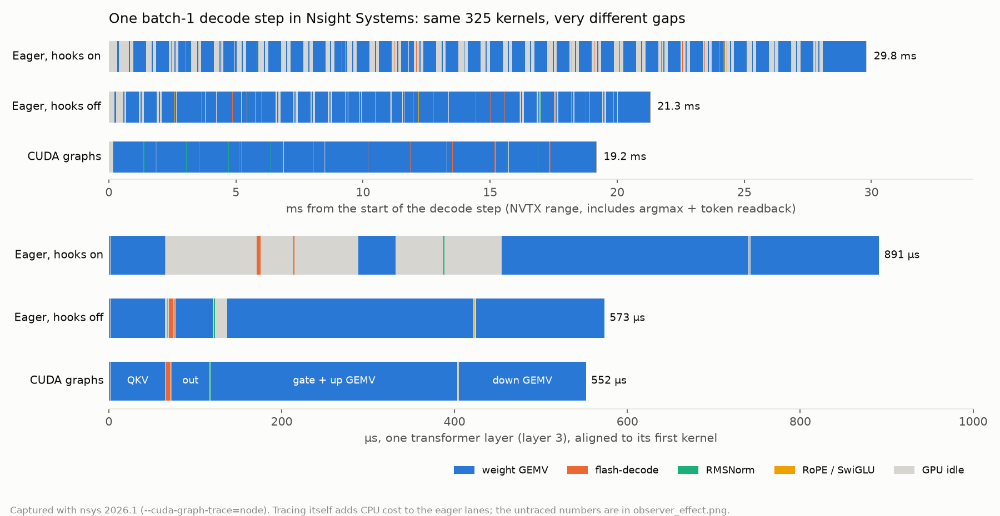

# Deck figures (2026-10-12)

Four summary figures, drawn by `deck_charts.py` from the CSVs next to it. RTX PRO 4500 Blackwell,
Llama 3.1 8B config, random fp16 weights, 512-token context unless noted.

## Roofline — `roofline.png`



- **Compute roof: 151 TFLOP/s**, the best of `torch.matmul` on 8192³ and 12288³ fp16 GEMMs. It's
  measured, not the datasheet number. **Memory roof: 820 GB/s**, the best isolated GEMV (`REPORT.md`);
  the 896 GB/s spec is dashed. Ridge point ≈ 184 FLOP/byte.
- **Blue:** every weight GEMM of one decode step (QKV, out, gate/up and down ×32 layers, plus lm_head),
  with FLOPs, bytes and time summed per batch size. Timed one GEMM at a time with L2 flushed
  (`roofline_gemms.csv`). Intensity is ≈ the batch size: 1 FLOP/byte at batch 1, ~120 at batch 128.
  Batch 128 is still left of the ridge, and achieved bandwidth there drops from ~800 to ~700 GB/s
  as cuBLAS switches from GEMV to tensor-core tiles (`BATCH.md`).
- **Orange:** flash-decode, from `batch_breakdown.csv`. With 4 query heads per KV head it does
  2 × 2 × 4 × 128 FLOPs per 512 bytes of K+V, so ~4 FLOP/byte at *every* batch size: batching
  doesn't make attention any less memory-bound. Batch 1 sits low because 600 tokens of KV is too
  little work to fill the GPU (0.2 ms per step).

## Batch-1 step breakdown — `batch1_breakdown.png`



Kernel times from one eager step under `torch.profiler`, with scopes off, so these are the same
kernels the graph replays (`batch1_ops.csv`). The cuBLAS GEMV kernels all have the same name, so
they're attributed by position: four per layer (QKV, out, gate/up, down), then lm_head.

- **Weight GEMVs: 18.55 of 19.05 ms (97%).** Everything else is 0.51 ms: attention 0.21, RMSNorm
  0.10, RoPE + KV write 0.03, SwiGLU 0.03, and 0.13 ms of gaps.
- The gaps are the measured CUDA-graph step time (19.05 ms, `bench_throughput.py --cuda-graphs`)
  minus the kernel sum (18.92 ms).
- Even fusing away every non-GEMV kernel and every gap would save at most 2.7% at this context.

## Observer effect — `observer_effect.png`



`bench_throughput.py` with and without `--profile-scopes` (the `record_function` hooks) and
`--cuda-graphs`; median of 3 runs (`observer_effect.csv`). The blue part of each bar is the
18.92 ms kernel sum from the breakdown above; the rest is the GPU waiting for launches.

| mode | ms/step | tok/s |
|---|---:|---:|
| eager, hooks on | 24.70 | 40.5 |
| eager, hooks off | 19.52 | 51.2 |
| CUDA graphs, hooks on | 19.05 | 52.5 |
| CUDA graphs, hooks off | 19.05 | 52.5 |

On this pod the hooks cost **21%** in eager mode. `REPORT.md` measured 12% (45.2 vs 51.4) on an
earlier pod. The difference is the host CPU, which is the point: in eager mode the result
depends on the CPU, and under CUDA graphs it doesn't.

## Nsight Systems trace — `trace_timeline.png`



Drawn from one steady-state step (the third of five) in each Nsight Systems capture
(`trace_step_b1.csv`). The GPU busy time is 18.89 ms in all three; only the gaps change.
Under nsys the eager lanes run slower than in the table above (21.3 and 29.8 ms), because
tracing adds CPU work per launch, and that only shows up when the CPU is the bottleneck.

The raw captures are **not in the repo**. An `.nsys-rep` stores the profiled process's environment
variables, and on the pod those include API keys and passwords (GitHub push protection caught a
RunPod key). `.gitignore` excludes them. Re-record with `harness/nsys_decode.py`, under `env -i`
if you want a capture you can share. The four captures used here, to open in the Nsight Systems
GUI (File → Open; 2026.1 or newer):

| file | what |
|---|---|
| `traces/decode_graphs_b1.nsys-rep` | batch 1, CUDA graphs, per-kernel nodes inside the graph |
| `traces/decode_graphs_b128.nsys-rep` | batch 128, CUDA graphs (~525-token context, so ~33 ms/step) |
| `traces/decode_eager_b1.nsys-rep` | batch 1, eager, hooks off |
| `traces/decode_eager-hooks_b1.nsys-rep` | batch 1, eager, profiler hooks on |

Each has 5 decode steps, each step inside an NVTX range `decode step i (batch B, mode)`. Every
step includes the argmax and the token copy to the host, like a real generation loop. Recorded with:

```bash
env -i PATH="$PATH" HOME="$HOME" \
nsys profile -t cuda,nvtx,osrt --cuda-graph-trace=node \
    --capture-range=cudaProfilerApi --capture-range-end=stop \
    -o decode_graphs_b1 python harness/nsys_decode.py 1 5 graphs
```

Nsight Compute (`ncu`) per-kernel reports weren't possible on this pod: the host driver blocks
GPU performance counters for containers (`ERR_NVGPUCTRPERM`).
